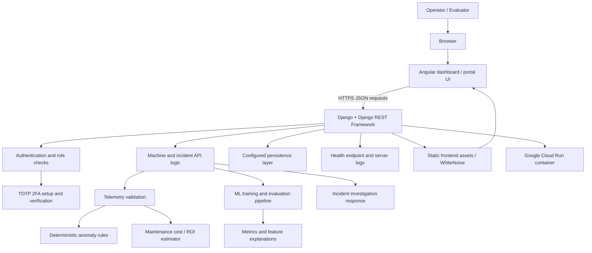
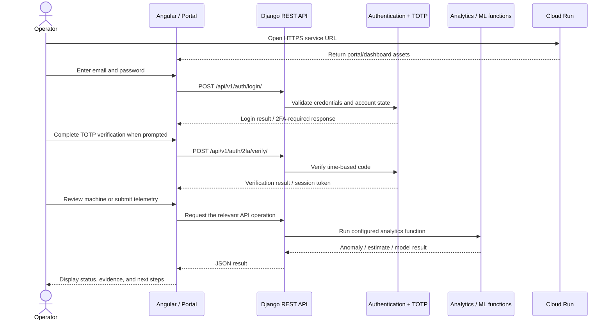

# AeroGuard AI Enterprise — FactoryMind
**AI Builder Cup 2026 (Google) | Industrial AI, Predictive Maintenance, Explainable Anomaly Detection**

AeroGuard AI Enterprise (also called **FactoryMind** in the code) is an industrial operations dashboard concept that brings machine telemetry, deterministic anomaly checks, maintenance-cost estimation, machine-learning experiments, explainability, incident investigation, user administration, and time-based one-time password (TOTP) two-factor authentication (2FA) into one web application.

This README expands the original project notes into a demonstration guide, system architecture, operational walkthrough, deployment reference, and production-readiness roadmap. The original setup instructions are retained in the **Original setup notes (preserved)** section at the end.

## 1. Project at a glance

### Purpose
Industrial equipment can fail because of abnormal vibration, rising temperature, increasing defect rates, or missed preventive maintenance. AeroGuard aims to help an operator spot suspicious readings, understand why a machine was flagged, estimate the cost of delaying maintenance, and organise a follow-up investigation.

### Main components visible in the repository
- **Angular 19 frontend**: dashboard interface and browser-side interaction.
- **Django 5.1 / Django REST Framework backend**: serves the portal, authentication endpoints, user management, health checks, and API routes.
- **Rule-based anomaly detection**: evaluates telemetry against explicit thresholds and machine-specific baselines.
- **Maintenance ROI estimator**: estimates planned intervention costs against a modelled run-to-failure scenario.
- **ML/XAI pipeline**: provides a training/evaluation pipeline across configured industrial datasets, metrics, confusion matrices, and feature-attribution outputs.
- **Incident investigation response**: creates a structured investigation result with ranked hypotheses, supporting/contradicting evidence, safety notes, and recommended actions. The current implementation must be checked before describing this response as a live call to Gemini/Vertex AI.
- **TOTP 2FA utilities and API endpoints**: generate provisioning data and verify six-digit time-based codes.
- **Google Cloud Run container deployment**: the supplied Dockerfile builds a Python container and starts Gunicorn on port `8080`.

### Technology stack
| Layer | Technology in repository | Role |
|---|---|---|
| Web UI | Angular 19, TypeScript, RxJS | Dashboard and user interaction |
| API/server | Python, Django 5.1, Django REST Framework | HTTP endpoints and business logic |
| Identity | Django custom `User` model, password authentication, TOTP utilities | Login, account roles, 2FA |
| Analytics | NumPy, pandas, scikit-learn, SciPy | Data processing and ML pipeline |
| Cloud | Google Cloud Run; Google Cloud libraries are dependencies | Container hosting and possible Vertex AI integration |
| Static assets | Angular production build, Django static files, WhiteNoise | Serve built frontend assets where configured |

## 2. What is implemented and what needs verification

Documentation must distinguish code that exists from a production integration that has been proven end-to-end.

| Area | Evidence in repository | What to verify during demonstration |
|---|---|---|
| Cloud Run | Dockerfile binds Gunicorn to `0.0.0.0:8080`; screenshot shows a successful deployment | Open the current service URL, inspect the active revision and logs, and test a health endpoint |
| Dashboard | Angular source and compiled output are present; a standalone HTML dashboard/template is also present | Confirm which UI is served by the deployed revision and that displayed values come from intended API responses |
| REST API | Django URL configuration includes health, login, 2FA setup/verify, and user-management routes | Test each endpoint and confirm status codes, response schema, and authentication requirements |
| Anomaly detection | `detect_machine_anomaly()` applies threshold and baseline rules | Use known normal and abnormal telemetry and check that results change accordingly |
| Maintenance estimate | `calculate_single_machine_maintenance_roi()` calculates estimated downtime, costs, and savings | Explain that outputs are model estimates; validate cost assumptions with plant data before operational use |
| ML evaluation | Dataset metadata and `train_hybrid_ml_xai_pipeline()` are present | Confirm whether training uses downloaded/real dataset records or generated/simulated samples; do not claim benchmark-grade real-world accuracy without reproducible evidence |
| Explainability | ML pipeline is described as hybrid ML/XAI and includes feature-attribution functionality | Confirm the method, output, model version, and feature mapping used for each explanation |
| Incident investigation | `run_gemini_incident_investigation()` returns structured hypotheses and actions | Inspect implementation and runtime logs to establish whether it actually calls Vertex AI/Gemini or currently constructs a local/template response |
| 2FA | TOTP helpers and setup/verify endpoints exist | Verify QR/provisioning URI, enrollment, leading-zero codes, invalid/expired codes, session token transition, and protected-route enforcement |
| Persistence | Django settings configure SQLite at `backend/aeroguard_factorymind.sqlite3` | Cloud Run's container filesystem is ephemeral; verify whether a deployed instance is using ephemeral SQLite. Do not treat it as durable  

**Demo honesty rule:** If the UI contains sample machines or preconfigured values, label them as demo/simulated telemetry. Avoid saying “live sensor feed,” “validated zero-day detection,” “production-ready,” or “live Gemini investigation” unless you have independently verified those claims.

## 3. Architecture

### Logical architecture



This diagram represents the intended logical flow and the code paths visible in the repository. It does **not** imply that every box is a separate deployed service or that all external integrations are active. The supplied Dockerfile starts one Django/Gunicorn application container; no separate worker, streaming broker, or sensor gateway is defined in that Dockerfile.

### Request path
1. An operator opens the Cloud Run service URL over HTTPS.
2. The container serves the portal/dashboard entry point and/or built static assets according to the current Django template and static-file configuration.
3. The browser sends requests to the Django API routes.
4. Django validates the request and, where implemented, checks authentication/2FA and user permissions.
5. The relevant service function evaluates the input: rule-based anomaly checks, maintenance-cost calculations, ML evaluation, or an investigation response.
6. Django serialises a response to JSON (the configured DRF renderer is JSON).
7. The frontend updates the displayed result; errors should be shown as errors rather than silently replaced with convincing-looking sample results.
8. Cloud Run logs and health checks help the operator diagnose failures. Persistent business records require an external durable database or storage service.

### Deployment architecture currently evidenced
- Google Cloud Run service: `aeroguard-enterprise-ai`
- Region shown in the screenshot: `asia-east1`
- Container listens on port `8080`
- Image build/deployment is performed from the repository root with `gcloud run deploy ... --source .`

## 4. End-to-end system flow



The exact frontend request sequence and authentication response schema should be verified against the deployed build. The diagram is a demonstration model, not a guarantee that every current UI action is already connected to every backend function.

### Machine evaluation lifecycle
1. **Input** — telemetry and baseline values are supplied for a machine.
2. **Normalisation** — numerical fields are converted to expected numeric types.
3. **Rule checks** — vibration, temperature, defect-rate and maintenance-age thresholds are evaluated.
4. **Risk summary** — the function returns an anomaly flag, risk score/level, trigger count and individual triggered rules.
5. **Economic estimate** — the ROI estimator estimates unplanned downtime, scrap, repair cost, planned intervention cost, and potential savings.
6. **Investigation** — a structured response ranks possible causes and suggests checks/actions.
7. **Operator review** — the operator should verify the machine, consult plant procedures, and approve any maintenance action. The software must not autonomously override industrial safety controls.

## 5. Machine-learning and explainability flow

The repository's `backend/core/ml_engine.py` includes:
- Metadata for five named industrial datasets: UCI AI4I 2020, a SMART Lab CNC tool-wear dataset, NASA C-MAPSS, UCI SECOM, and Bosch Production Line Performance.
- A deterministic telemetry anomaly detector.
- A per-machine maintenance ROI estimator.
- A training/evaluation pipeline named `train_hybrid_ml_xai_pipeline()`.
- An incident investigation function named `run_gemini_incident_investigation()`.

### Explain the layers separately
1. **Rule-based detection**: deterministic checks against explicit values and baselines. It is easy to audit but only detects patterns represented by its rules.
2. **Supervised classification**: learns a mapping from labelled examples to known classes. It requires reliable labels and representative train/validation/test splits.
3. **Novelty / out-of-distribution detection**: aims to flag observations unlike the training distribution. This requires a separately designed and validated method; a multiclass classifier alone does not prove zero-day or unseen-fault detection.
4. **Explainability (XAI)**: reports which features influenced a model output. Feature attribution is not proof of causation and can be unstable or misleading if the model/data pipeline is flawed.
5. **Investigation assistance**: organises evidence and candidate causes for human review. Generated or template hypotheses must be distinguished from verified physical findings.

### Required evidence before production claims
- Dataset licences, provenance, collection dates, and permissible use documented.
- Reproducible preprocessing and feature definitions.
- Separate train, validation, and test sets with leakage controls.
- Per-class precision, recall, F1, confusion matrix, calibration, and false-negative/false-positive analysis.
- Baselines against simple heuristics and existing maintenance practice.
- Model/version tracking, reproducible seeds, artefact hashes, and evaluation reports.
- Explainability sanity checks, stability analysis, and expert review.
- Monitoring for sensor drift, data quality, model drift, and changing plant conditions.
- Explicit UI labelling of measured values, calculated values, model predictions, and generated hypotheses.

## 6. Authentication and 2FA flow

### Intended login stages
1. The user submits email and password to `POST /api/v1/auth/login/`.
2. The server checks credentials and account status.
3. When 2FA is required, the client proceeds to setup or verification rather than treating the first login response as a fully authenticated session.
4. For enrollment, `POST /api/v1/auth/2fa/setup/` returns setup/provisioning information as implemented by the API.
5. The user enters the six-digit authenticator code through `POST /api/v1/auth/2fa/verify/`.
6. Only after successful verification should the frontend store/use the intended authenticated session token and permit protected actions.

The code in `backend/core/totp_security.py` contains utilities for RFC 6238-style TOTP codes, Base32 secrets, provisioning URIs, and signed tokens. The views and frontend must still be tested together; the presence of a utility is not by itself proof that every route is protected correctly.

### Production requirements for identity
- Replace any development/default signing secret with a high-entropy secret in Secret Manager.
- Never commit real credentials or TOTP secrets.
- Enforce 2FA consistently on the server, not just by hiding frontend screens.
- Use short-lived access tokens, rotation/revocation strategy, secure cookie/storage practices, issuer/audience checks, and CSRF protection where applicable.
- Add login throttling, lockout policy, password reset, account recovery, and security notifications.
- Use least-privilege role checks for each API action. The current model includes `SUPER_ADMIN` and `SYSTEM_ADMIN`; review permission methods and defaults carefully before production.
- Audit enrolment, verification failures, role changes, account changes, and recovery events without logging passwords, OTP values, tokens, or secrets.

## 7. API surface

The current Django URL configuration exposes the following paths:

| Method | Path | Purpose | Demo check |
|---|---|---|---|
| GET | `/` | Portal home | Loads the application/portal |
| GET | `/health/` | Server health check | Returns a successful health response |
| GET | `/api/v1/health/` | API health check | Returns a successful health response |
| POST | `/api/v1/auth/login/` | Email/password login | Verify valid, invalid, and locked/disabled-account behaviour |
| POST | `/api/v1/auth/2fa/setup/` | 2FA enrollment/setup | Verify authenticated/authorised setup and QR/provisioning response |
| POST | `/api/v1/auth/2fa/verify/` | TOTP verification | Verify valid and invalid codes and token/session transition |
| GET/POST/other supported methods | `/api/v1/users/` | User management | Verify exact methods, role requirements, validation and audit events |

The table lists URL patterns, not a guarantee that all methods are enabled or that authorization is production-safe. Confirm exact behaviour in `backend/core/views.py` and against the live service. Machine analytics functions exist in the code, but the current `backend/core/urls.py` does not register dedicated machine/ML/incident API paths. Do not assume those functions are externally callable through REST until explicit routes and views are added.

### Basic health checks
Replace the URL below if the service URL changes:

```bash
export BASE_URL="https://aeroguard-enterprise-ai-908509519555.asia-east1.run.app"

curl -i "$BASE_URL/health/"
curl -i "$BASE_URL/api/v1/health/"
```

Use `-i` to inspect HTTP status and headers. A successful health endpoint confirms only that the endpoint responds; it does not prove that authentication, database persistence, ML, or external services are working.

## 8. Repository structure

```text
aeroguard-enterprise-ai-main/
├── README.md
├── Dockerfile
├── build_aeroguard_enterprise.py
├── aeroguard_factorymind_dashboard.html
├── design-inspiration/
│   ├── DESIGN_SYSTEM_SYNTHESIS.md
│   └── tokens.json
├── backend/
│   ├── manage.py
│   ├── requirements.txt
│   ├── aeroguard_factorymind.sqlite3
│   ├── aeroguard_backend/
│   │   ├── settings.py
│   │   ├── urls.py
│   │   └── wsgi.py
│   └── core/
│       ├── migrations/
│       ├── models.py
│       ├── views.py
│       ├── urls.py
│       ├── ml_engine.py
│       ├── totp_security.py
│       ├── portal_template.py
│       └── test_suite.py
├── frontend/
│   ├── package.json
│   ├── package-lock.json
│   ├── angular.json
│   ├── dev-server.js
│   ├── src/
│   └── dist/
```

`frontend/node_modules/` and generated output may appear in a development ZIP. Do not rely on vendored `node_modules` in source control; rebuild dependencies from the lockfile. The SQLite file and compiled `dist/` output are present in the supplied archive, but production deployment should use controlled migrations/builds and durable managed storage.

## 9. Run locally

### Prerequisites
- Python 3.10 or a compatible Python version supported by the pinned dependencies.
- Node.js/npm compatible with Angular 19.
- Git (optional, recommended).
- A terminal at the repository root.

### A. Start the backend

```bash
cd backend
python3 -m venv venv
source venv/bin/activate
python -m pip install --upgrade pip
pip install -r requirements.txt

python manage.py check
python manage.py migrate
python manage.py runserver 0.0.0.0:8000
```

The API server should then be available at `http://127.0.0.1:8000`. The development server is for local work only; do not expose it publicly.

### B. Start the frontend in another terminal

```bash
cd frontend
npm ci
npm start
```

The original README says the frontend opens at `http://localhost:4200` and connects to `http://localhost:8000/api/v1`. Check `frontend/dev-server.js` and frontend configuration to confirm the proxy/base URL. If the Angular app is served through Django's built assets instead, use the backend's root URL.

### C. Build the Angular production bundle

```bash
cd frontend
npm ci
npm run build
```

Inspect the generated output path and make sure it matches the Django template/static configuration before building the container. Angular output directories can change with the Angular builder configuration.

### D. Test the standalone backend verification suite

The repository's original suite imports local modules as though run from `backend/core`. Run it from that directory:

```bash
cd backend/core
python3 test_suite.py
```

The test suite uses numerical/ML dependencies and may take time because it exercises multiple dataset configurations. A passing standalone suite does not replace Django API integration tests or a Cloud Run smoke test.

## 10. Google Cloud Run deployment

### Current deployment shown in the supplied screenshot
The screenshot shows the following command completed successfully from the project root:

```bash
gcloud run deploy aeroguard-enterprise-ai \
  --source . \
  --region asia-east1 \
  --allow-unauthenticated
```

It reports that the service was deployed and serving 100% of traffic. The screenshot's service URL is:

`https://aeroguard-enterprise-ai-908509519555.asia-east1.run.app`

**Important:** `--allow-unauthenticated` makes the service publicly reachable. HTTPS does not make an application private. Before real users or operational data are introduced, configure the correct access model and enforce authentication/authorisation at the application/API level.

### Re-deploy after a README or code change
From the repository root:

```bash
gcloud config get-value project
gcloud run services describe aeroguard-enterprise-ai \
  --region asia-east1 \
  --format="value(status.url)"

gcloud run deploy aeroguard-enterprise-ai \
  --source . \
  --region asia-east1
```

Use the unauthenticated flag only if public access is deliberately intended for a demo. If the service is already configured for public invocation, omitting the flag does not necessarily remove that permission; review IAM explicitly.

### Inspect service and logs

```bash
gcloud run services describe aeroguard-enterprise-ai \
  --region asia-east1

gcloud run revisions list \
  --service aeroguard-enterprise-ai \
  --region asia-east1

gcloud run services logs read aeroguard-enterprise-ai \
  --region asia-east1 \
  --limit 100
```

If the CLI version does not support the service logs command, use **Google Cloud Console → Cloud Run → aeroguard-enterprise-ai → Logs** or Cloud Logging.

### Container behaviour
The repository Dockerfile:
1. Uses `python:3.10-slim`.
2. Installs build tools and Python requirements plus Gunicorn and WhiteNoise.
3. Copies the repository into `/app`.
4. exposes port `8080`.
5. runs Django migrations, collects static files, and starts Gunicorn bound to `0.0.0.0:8080`.

For production, do not automatically run migrations concurrently from every new application instance. Use a controlled release/migration job, test migrations against a staging database, and ensure rollback compatibility. Configure CPU/memory, concurrency, request timeout, minimum/maximum instances, and health probes based on measured load.

### Configuration and secrets
Use environment variables and Secret Manager for:
- Django secret/signing keys.
- Database credentials and connection settings.
- External AI service configuration.
- Third-party API keys and credentials.
- Allowed hostnames, trusted origins, and CORS allowlist.
- Any email/SMS notification provider credentials.

Do not bake secrets into the Docker image, commit them to source control, or place them in frontend environment files that are shipped to the browser.

## 11. Production-readiness gaps and recommended changes

This section is the priority list before using AeroGuard with real factories, accounts, or operational decisions.

### P0 — Security and access control
- **Rotate secrets:** the settings file contains a fallback `SECRET_KEY`; remove insecure defaults and fail startup if a required production secret is absent.
- **Restrict public access:** decide between Cloud Run IAM authentication, Identity-Aware Proxy, or application-level identity. Do not rely on a hidden UI route.
- **Lock down CORS and hosts:** `ALLOWED_HOSTS = ['*']` and `CORS_ALLOW_ALL_ORIGINS = True` are too broad for a production service. Allow only intended domains and configure CSRF trusted origins.
- **Review the custom user model:** methods such as `has_perm()` and `has_module_perms()` currently return `True`; this can undermine Django's permission model if relied on. Replace with explicit, tested permission logic.
- **Review default accounts/passwords:** remove default passwords and hard-coded privileged email addresses; bootstrap the first administrator securely and require password change.
- **Prove 2FA enforcement:** verify every protected endpoint server-side. Add rate limits, replay protections where appropriate, recovery codes, device/session revocation, and safe recovery.
- **Harden tokens:** replace development signing defaults; validate expiry, scope, issuer, audience and token type; implement revocation/rotation and secure storage.
- **Audit logging:** create tamper-resistant, access-controlled audit events for authentication, privilege changes, and sensitive actions. Never log credentials or secrets.
- **Dependency and image security:** pin dependencies, scan for vulnerabilities, use a minimal non-root container, and generate an SBOM.

### P0 — Durable data and database
- **Move off SQLite for Cloud Run production.** Cloud Run instances can be replaced and their writable container filesystem is not durable shared storage. Use Cloud SQL for PostgreSQL (or another managed transactional database), private connectivity where appropriate, and managed credentials.
- Add tested migrations and a controlled migration job.
- Configure automated backups, point-in-time recovery, retention, restore drills, and a documented recovery objective.
- Store large telemetry files and model artefacts in Cloud Storage rather than in the container.

### P1 — Correctness and end-to-end integration
- Create explicit, versioned REST routes and serializers for machines, telemetry ingestion, anomaly results, model jobs/results, incidents, explanations, and audit events.
- Connect each dashboard card/chart/action to a real endpoint. Remove mock/fallback success data from production paths; show loading, empty, stale, and error states distinctly.
- Define schemas and units for telemetry, timestamps, machine identity, sensor quality, baselines, and missing values.
- Add idempotency and validation for ingestion; protect against duplicate, stale, out-of-order, malformed, or implausible readings.
- Add pagination, filtering, sorting, date ranges, and API versioning.
- Add integration tests proving the full browser → API → business logic → persistent storage → browser path.
- Confirm whether the investigation function uses Vertex AI. If yes, configure workload identity/service account permissions, timeouts, quotas, retries, model/version selection, and graceful failure. If not, label the feature as a local prototype until integration is completed.

### P1 — Real industrial data and model governance
- Integrate a real ingestion path (gateway, MQTT broker, OPC UA connector, historian, or authenticated batch upload) with network segmentation and certificate-based device identity.
- Define sensor calibration, units, sampling rates, timestamps, missing-data handling, and machine-to-sensor mapping.
- Validate the ML pipeline on representative plant data and unseen operating periods; report per-class metrics and confidence intervals.
- Separate demo/synthetic data from production datasets at the storage and UI layers.
- Version models and features; record dataset/model versions for each prediction.
- Establish drift monitoring, retraining approvals, rollback, model cards, and human review for high-impact alerts.
- Treat ROI estimates as configurable scenarios with documented assumptions and sensitivity ranges.

### P1 — Reliability and operations
- Add structured JSON logs with correlation/request IDs, metrics, tracing, error reporting, and alerting.
- Configure Cloud Monitoring alerts for elevated 5xx errors, latency, instance restarts, CPU/memory pressure, and quota exhaustion.
- Add request timeouts, bounded retries with exponential backoff, circuit breakers for external dependencies, and idempotent background jobs.
- Use a task queue for expensive training and long-running investigations instead of executing them synchronously in a web request.
- Configure staging and production environments, controlled releases, revision traffic splitting, rollback procedures, and deployment approvals.
- Define service-level objectives, on-call ownership, incident response, backup recovery, and disaster-recovery procedures.

### P2 — Product and usability
- Add organisation/site/plant/line/machine hierarchy and tenant isolation if serving multiple customers.
- Add asset inventory, sensor health, maintenance work orders, technician assignment, acknowledgement, escalation and closure workflows.
- Add configurable alert rules, notification channels (email/SMS/ChatOps), quiet hours and alert deduplication.
- Add role-specific views and a clear permission matrix for administrators, reliability engineers, technicians and read-only viewers.
- Add report export, scheduled reports, evidence attachments, comments, and a complete incident timeline.
- Add localisation, accessibility, responsive layouts, user preferences, and clearer provenance labels for AI-generated text.
- Add onboarding, password reset, account recovery, user/session management, and administrative audit views.

### P2 — Privacy, compliance and governance
- Document data classification, retention, deletion, access review, and customer data ownership.
- Encrypt data in transit and at rest; manage keys and rotation centrally.
- Add vulnerability management, security reviews, penetration tests, threat modelling, and incident response exercises.
- Define whether data is subject to customer contractual, industry, or jurisdiction-specific obligations; obtain qualified advice where needed.
- Document the boundaries of AI recommendations and require qualified human approval for maintenance and safety actions.

## 12. Prioritised future roadmap

| Phase | Target | Deliverables / exit criteria |
|---|---|---|
| Phase 0 — Demo hardening | Before judging or stakeholder demo | Reliable Cloud Run URL; working login/2FA; known demo credentials; synthetic telemetry clearly labelled; smoke-test checklist; no secret values in logs |
| Phase 1 — Secure MVP | Before external pilot | Restricted IAM/CORS/hosts; secure secrets; PostgreSQL/Cloud SQL; migrations/backups; verified permissions; API integration tests; CI build/test pipeline |
| Phase 2 — Operational data | Before plant trial | Real telemetry ingestion; asset/sensor registry; data quality checks; durable event history; alert acknowledgement and incident workflow |
| Phase 3 — Validated intelligence | Before using predictions operationally | Representative labelled data; reproducible evaluation; calibrated alerts; explainability validation; drift monitoring; model versioning; expert sign-off |
| Phase 4 — Production operations | Before general availability | Observability/SLOs; autoscaling/load tests; backup restore drills; rollback and incident runbooks; security assessment; support process |
| Phase 5 — Enterprise expansion | After a stable production baseline | Multi-tenancy; SSO/SCIM if needed; integrations with CMMS/ERP/historian; advanced reporting; tenant-level audit/retention; governance controls |

### Suggested acceptance gates
- **Security gate:** no critical/high unresolved findings; permission tests cover every sensitive endpoint; secrets are centrally managed.
- **Data gate:** persistent storage and successful restore test; validated ingestion schema and retention policy.
- **Model gate:** independent holdout evaluation and documented false-alarm/missed-detection rates accepted by domain experts.
- **Reliability gate:** load test, alerting, rollback and incident-response drills completed.
- **Human safety gate:** recommendations are advisory, procedures are visible, and only authorised people approve maintenance actions.

## 13. Security and safety notice

AeroGuard is a prototype/demo unless and until the production-readiness gates above have been completed. The current repository contains a SQLite database file and has code-level defaults that require review before production. The screenshot confirms that a Cloud Run deployment command succeeded; it does not certify the application as secure, durable, scalable, or ready for industrial operation.

- Never paste real passwords, OTP codes, TOTP seeds, access tokens, private keys, or service-account JSON into this README or a public repository.
- Use synthetic telemetry for public demos.
- Do not connect an unvalidated prototype directly to safety-critical machine controls.
- A prediction or generated hypothesis is not a confirmed diagnosis. Qualified personnel must validate findings and follow site-specific lockout/tagout and safety procedures.
- Verify the current Google Cloud project, service URL, region, revision, IAM policy, logs, and configured environment before each presentation or release.
